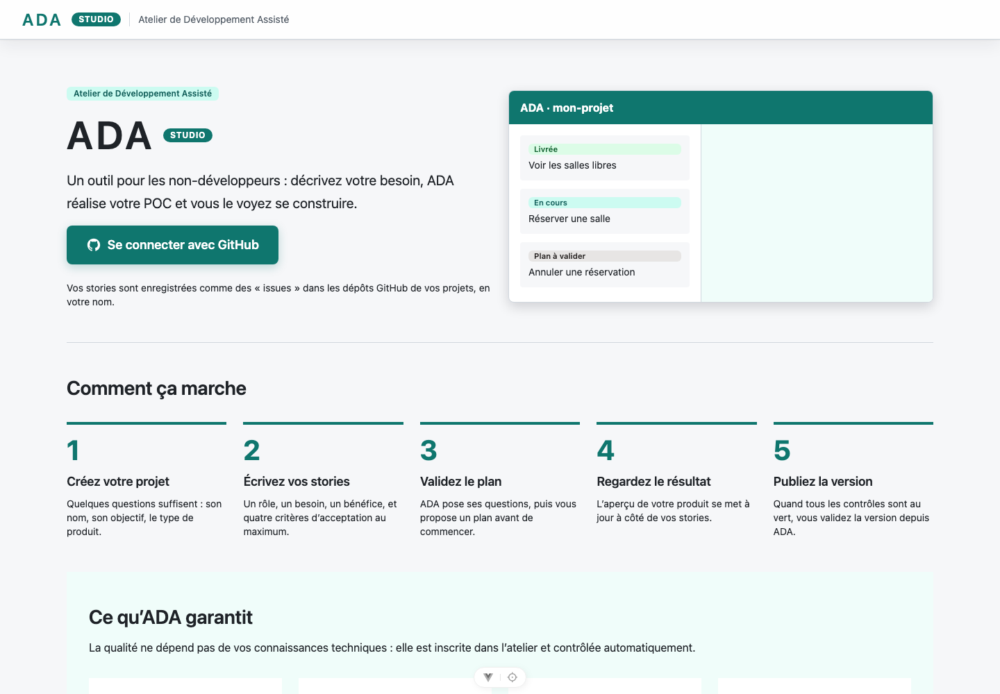
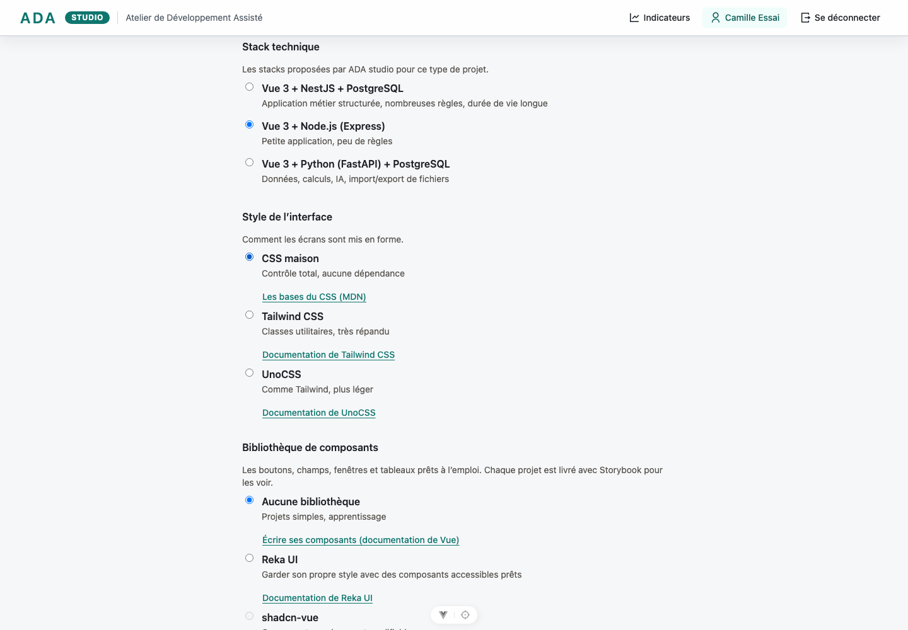
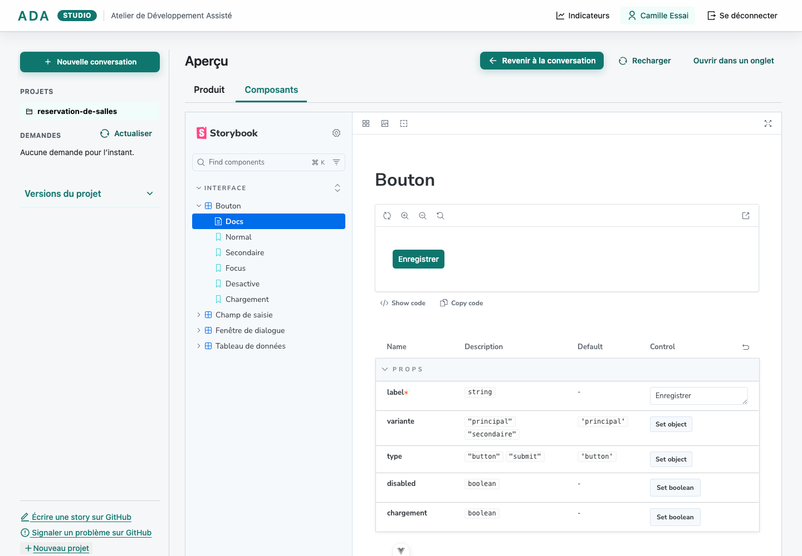

# ADA studio — Atelier de Développement Assisté

**Une interface de développement no-code.** ADA studio permet à une personne qui ne code pas de
réaliser ses POC avec un assistant de code. Elle crée un projet, décrit ses besoins sous forme de
user stories ou signale des problèmes. L'assistant pose ses questions, fait valider un plan, code
avec tests et contrôle d'accessibilité, puis livre une pull request. Elle est fusionnée quand la
CI est verte.

ADA studio ne porte **aucune identité de l'État** : ni son interface, ni les projets qu'elle crée.
À la création de chaque projet, on **choisit son style et sa bibliothèque de composants**, et
chaque projet avec écrans est livré avec **Storybook**.

> 🤖 Vous êtes un agent de codage ? Lisez [`AGENTS.md`](AGENTS.md).

## Aperçu

*Captures avec des données de démonstration.*



**Nouveau projet** : le style et la bibliothèque de composants, une combinaison impossible désactivée.



**L'onglet « Composants »** : le Storybook du projet, à côté de l'aperçu du produit.



Storybook d'un projet d'essai par bibliothèque : [aucune](docs/captures/storybook-aucune.png),
[Reka UI](docs/captures/storybook-reka-ui.png), [shadcn-vue](docs/captures/storybook-shadcn-vue.png),
[PrimeVue](docs/captures/storybook-primevue.png), [Vuetify](docs/captures/storybook-vuetify.png),
[Naive UI](docs/captures/storybook-naive-ui.png).

## Deux ADA, une édition : `studio`

ADA studio coexiste avec l'ADA du travail, sur la même machine et le même compte GitHub. Le
fichier [`EDITION`](EDITION), à la racine, contient `studio` : sans lui, l'API et les scripts
refusent de démarrer.

| | ADA (travail) | ADA studio |
|---|---|---|
| Dossier | `~/atelier-po` | `~/ada-studio` |
| Dépôt GitHub | `Ada` | `ada-studio` (privé) |
| Ports | 5180, 3100, 5300-5499 | 5700-5899 (voir ci-dessous) |
| Conteneurs et volumes | `apercu-*`, `atelier-po-*` | `ada-studio-*` |
| Sujet GitHub des projets | `ada` | `ada-studio` |
| Cookie de session, stockage local | `atelier.sid`, `ada:` | `ada-studio.sid`, `ada-studio:` |
| GitHub App | celle d'ADA | « ADA studio », distincte |
| Nom affiché | ADA | ADA + badge « studio », onglet « ADA studio » |

Ports d'ADA studio : 5700 interface, 5701 API, 5702 Storybook de l'interface, 5710-5769 aperçus,
5770-5829 Storybook des aperçus (onglet « Composants »), 5830-5899 liens de démonstration.

Un projet créé par ADA studio porte le sujet GitHub `ada-studio` et `"edition": "studio"` dans
son `ada.json`. ADA studio refuse d'ouvrir un projet de l'autre édition, et dit pourquoi.

## Style et bibliothèque de composants

Pour les modèles avec écrans, le formulaire de création propose deux choix. Toutes les options
sont gratuites, sous licence MIT et compatibles Vue 3. Par défaut : CSS maison, sans bibliothèque.

| Composants \ Style | CSS maison | Tailwind CSS 4 | UnoCSS |
|---|---|---|---|
| Aucune (composants du projet) | ✅ | ✅ | ✅ |
| Reka UI | ✅ | ✅ | ✅ |
| shadcn-vue | ❌ | ✅ | ❌ |
| PrimeVue 4 | ✅ | ✅ | ❌ |
| Vuetify 3 | ✅ | ❌ | ❌ |
| Naive UI | ✅ | ✅ | ✅ |

La base de chaque modèle est « CSS maison + aucune ». Les autres choix sont des **variantes**
([`variantes/`](variantes/)), appliquées à la création par une fonction unique
([`scripts/variantes.mjs`](scripts/variantes.mjs)), qui refuse une combinaison interdite.
Les combinaisons et leurs raisons sont dans [`variantes/combinaisons.json`](variantes/combinaisons.json).

## Ce que chaque projet reçoit dès sa création

| Élément | Rôle |
|---|---|
| CI (`ci.yml`) : anti-fuite, lint, types, tests (dont accessibilité), compilation | Vérifie automatiquement chaque changement |
| Storybook (`npm run storybook`), une story par composant, exécutée comme test | Voir les composants et leurs états ; une violation d'accessibilité fait échouer |
| gitleaks (pre-commit + CI), `.gitignore` durci, `private/` | Aucun secret, aucune donnée réelle |
| release-please | Versions et journal des changements automatiques |
| `AGENTS.md` (+ `CLAUDE.md` qui l'importe), avec sa section « Interface » | Le projet fonctionne avec n'importe quel agent, dans le style choisi |
| ADR-0001 « Choix de la stack » | Garde la trace des choix techniques, interface comprise |
| Modèles d'issues (story, bug) et de PR | Même format que l'interface web |
| Contrôle « Taille des fichiers » | Un fichier, une responsabilité : 400 lignes non vides au plus (600 pour un test) |
| Protection de `main` (posée par l'interface web) | Rien n'entre sans PR ni contrôles verts |

Aucune licence n'est mise par défaut dans les projets créés : ils appartiennent à la personne
qui les crée.

## Skills

| Skill | Ce qu'elle fait |
|---|---|
| `po-projet-nouveau` | Nom → objectif → stack → style et bibliothèque → squelette testé, Storybook, CI, anti-fuite, release-please, ADR-0001 |
| `po-story` | Story complète et courte → plan validé → tests d'abord, une story Storybook par nouveau composant → RGAA → périmètre → fiche |
| `po-bug` | Constat → hypothèses → test rouge → correction minimale → fiche |

Toutes trois ont un effet de bord : elles ne se lancent que **sur demande explicite**.

## Utiliser

**Avec l'interface web** (`interface/`) : connexion GitHub, stories à gauche, aperçu du produit et
de ses composants à droite. Installer et lancer ADA studio pas à pas :
[interface/README.md](interface/README.md).

**Avec VS Code** : ouvrir `ada-studio.code-workspace`, puis `/po-projet-nouveau`, `/po-story …`,
`/po-bug …`. Guide : [GUIDE-PO.md](GUIDE-PO.md).

## Contribuer

[CONTRIBUTING.md](CONTRIBUTING.md). Vérifications :
```bash
node scripts/verifier-skills.mjs
node scripts/skills-index.mjs --check
node scripts/verifier-modele.mjs vue-nest --style tailwind --composants shadcn-vue
node --test scripts/variantes.test.mjs
```

## Licence

Logiciel propriétaire, tous droits réservés : voir [`LICENSE`](LICENSE).
ADA studio n'est pas un logiciel libre : toute réutilisation demande un accord écrit.
Les dépendances gardent leurs propres licences : [docs/licences-dependances.md](docs/licences-dependances.md).
